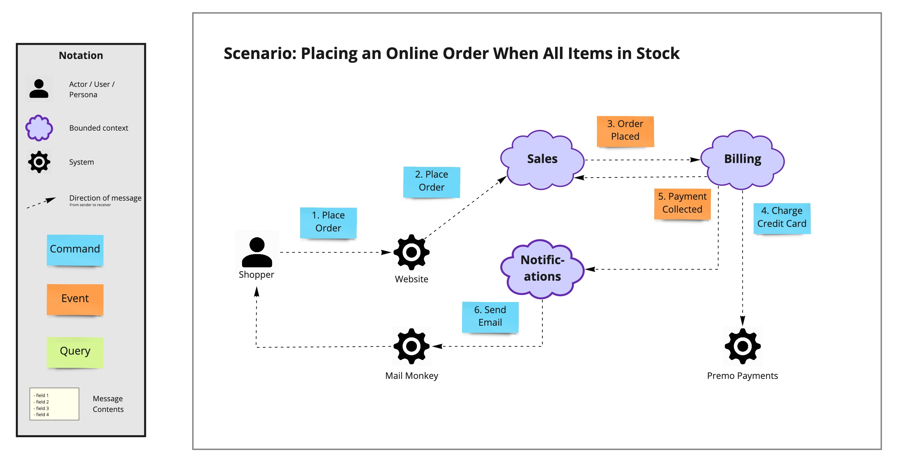
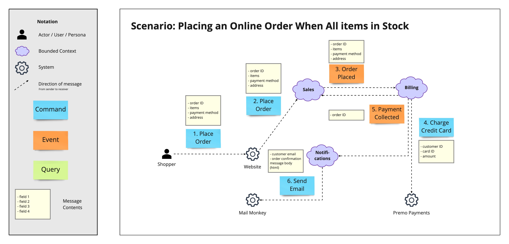
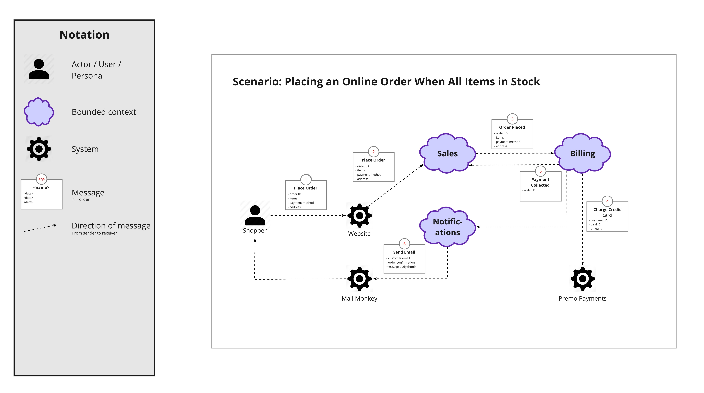
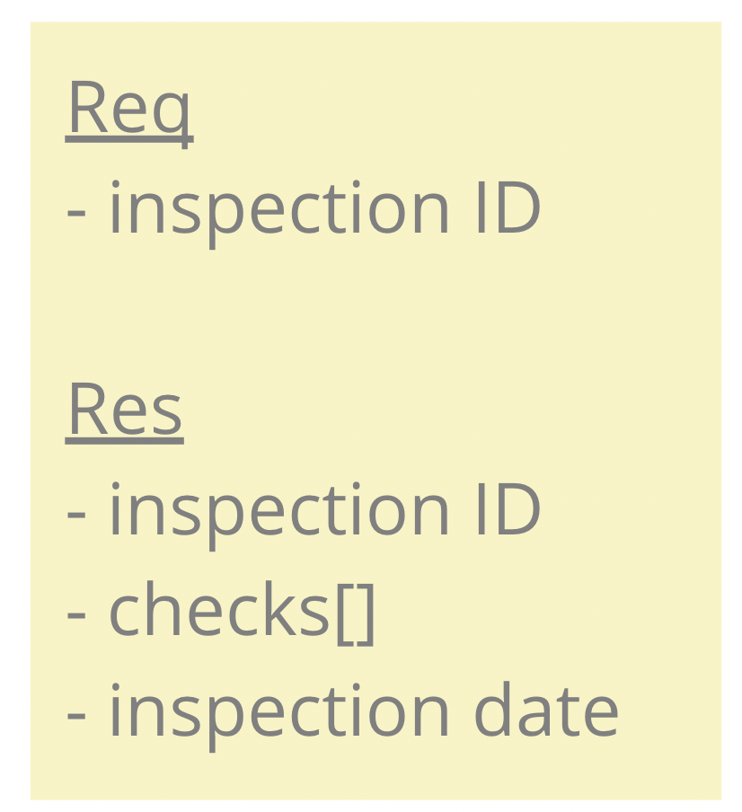
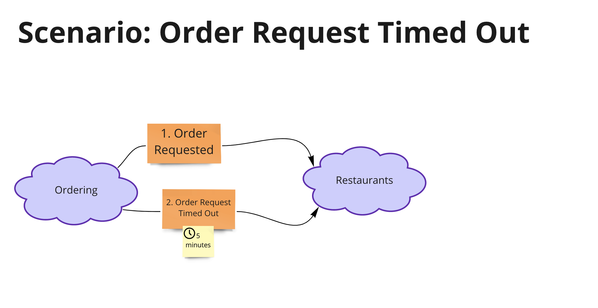

# Domain Message Flow Modelling

> **Nota sobre os elementos visuais:** os diagramas e o backup do quadro do Miro reutilizados nesta tradução permanecem em inglês. Na primeira ocorrência de um rótulo visual relevante, o termo original é apresentado entre parênteses para facilitar sua identificação nos recursos.

Projetar sistemas com baixo acoplamento exige mais do que fronteiras cuidadosamente definidas. As interações entre contextos delimitados também precisam ser projetadas com atenção.

Um [contexto delimitado (*Bounded Context*)](https://martinfowler.com/bliki/BoundedContext.html) é um subsistema de uma arquitetura de software alinhado a uma parte do domínio. Ele pode ser implementado como um microsserviço ou como um módulo dentro de um monólito.

Um **Diagrama de Fluxo de Mensagens do Domínio (*Domain Message Flow Diagram*)** é uma visualização simples do fluxo de mensagens — comandos, eventos e consultas — entre atores, contextos delimitados e sistemas em um cenário específico.

## Formatos

Existem dois formatos básicos, mas não há uma especificação formal. Portanto, adapte a técnica às suas necessidades caso os formatos apresentados não sejam adequados ao seu contexto.

### Mensagem e conteúdo separados (*Separate Message & Contents*)

O formato de mensagem e conteúdo separados utiliza dois elementos para cada mensagem: um para representar o nome e a ordem da mensagem e outro para apresentar seu conteúdo, ou seja, as informações que ela transporta.

A vantagem desse formato é permitir que você se concentre inicialmente no fluxo das mensagens, sem se prender aos detalhes do conteúdo de cada uma.

Comece representando apenas as mensagens que fluem entre remetentes (*senders*) e destinatários (*receivers*), incluindo o número de ordem em cada mensagem.

Em seguida, apresente o conteúdo de cada mensagem em uma caixa separada, posicionada próxima à mensagem correspondente:

### Mensagem e conteúdo combinados (*Combined Message & Contents*)

O formato de mensagem e conteúdo combinados utiliza um único elemento para registrar o nome, a ordem e o conteúdo da mensagem.

Esse formato é adequado quando você deseja analisar o conteúdo de cada mensagem desde o início da modelagem.

### Arquivos para download

- [Domain Message Flow Modelling — backup do quadro do Miro em inglês](../../resources/Domain-Message-Flow-Modelling-en-v1.rtb)

## Como usar

Quando você já tiver uma primeira versão da arquitetura e tiver identificado contextos delimitados candidatos, poderá começar a projetar os fluxos de mensagens.

Comece criando uma lista dos cenários que deseja modelar. Em seguida, produza um diagrama para cada cenário.

Ao criar um diagrama, o fluxo de trabalho típico é:

1. Comece com um ator, contexto ou sistema.
2. Crie a mensagem que esse participante deseja enviar.
3. Adicione o destinatário da mensagem e uma linha conectando o remetente ao destinatário.
4. Posicione a mensagem próxima à linha.
5. Repita as etapas de 1 a 4 até concluir o cenário.

Cada mensagem deve conter três elementos:

1. O nome da mensagem.
2. Os dados relevantes transportados pela mensagem.
3. A ordem em que a mensagem ocorre no fluxo modelado.

> **Observação:** no caso de uma consulta (*query*), a resposta é tão importante quanto a solicitação. A solicitação e a resposta podem ser compreendidas e representadas como uma única unidade, como no exemplo a seguir.

## Dicas de visualização

O principal problema dos Diagramas de Fluxo de Mensagens do Domínio — e dos diagramas em geral — é o excesso de informação. A [Lei de Miller (*Miller's Law*)](https://en.wikipedia.org/wiki/Miller%27s_law) é uma boa heurística nesse contexto. Procure manter entre cinco e nove mensagens em cada diagrama.

Caso a inclusão dos dados de cada mensagem esteja interrompendo o progresso da modelagem, deixe essa etapa para depois de posicionar todas as mensagens.

### Mensagens dependentes de tempo (*Time-Dependent Messages*)

Algumas mensagens são acionadas pelo tempo. Por exemplo: cancelar um pedido on-line após cinco minutos de inatividade. Uma visualização como a apresentada abaixo pode funcionar bem.

É importante observar cuidadosamente a semântica: **dentro de (*within*)**, **após (*after*)** e **a cada (*every*)** cinco minutos representam condições muito diferentes.

## Recursos adicionais

- [DDD Pattern: Library Contexts](https://medium.com/nick-tune-tech-strategy-blog/ddd-pattern-library-contexts-d6ae81f462ef)
- [Mapper Contexts & Supercontexts: Decoupling Domain-Specific and Domain-Generic Bounded Contexts](https://medium.com/nick-tune-tech-strategy-blog/mapper-contexts-supercontexts-decoupling-domain-specific-and-domain-generic-bounded-contexts-5eb6a1e7c5fc)
- [Gateway Interchange Contexts](https://medium.com/nick-tune-tech-strategy-blog/gateway-interchange-contexts-899696e67848)

## Colaboradores

Agradecemos a todos os [colaboradores atuais e futuros](https://github.com/ddd-crew/domain-message-flow-modelling/graphs/contributors) e às seguintes pessoas, que contribuíram para o Domain Message Flow Modelling:

- [Kacper Gunia](https://github.com/cakper)
- [Zsofia Herendi](https://twitter.com/zherendi)
- [Nick Tune](https://github.com/ntcoding)

Os Diagramas de Fluxo de Mensagens do Domínio foram fortemente inspirados por:

- [C4 Container Diagrams, de Simon Brown](https://c4model.com/)
- [Domain Storytelling](https://domainstorytelling.org/)

## Contribuições e feedback

A notação Domain Message Flow Modelling está disponível gratuitamente para uso. Comentários e ideias para aprimorar a técnica ou criar versões alternativas também são bem-vindos.

Você também pode enviar um pull request com seus próprios exemplos.

[![CC BY 4.0][cc-by-shield]][cc-by]

Este trabalho está licenciado sob a [Licença Internacional Creative Commons Atribuição 4.0][cc-by].

[![CC BY 4.0][cc-by-image]][cc-by]

[cc-by]: http://creativecommons.org/licenses/by/4.0/
[cc-by-image]: https://i.creativecommons.org/l/by/4.0/88x31.png
[cc-by-shield]: https://img.shields.io/badge/License-CC%20BY%204.0-lightgrey.svg
